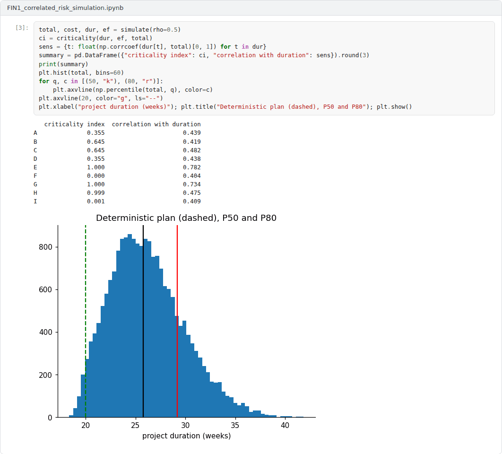
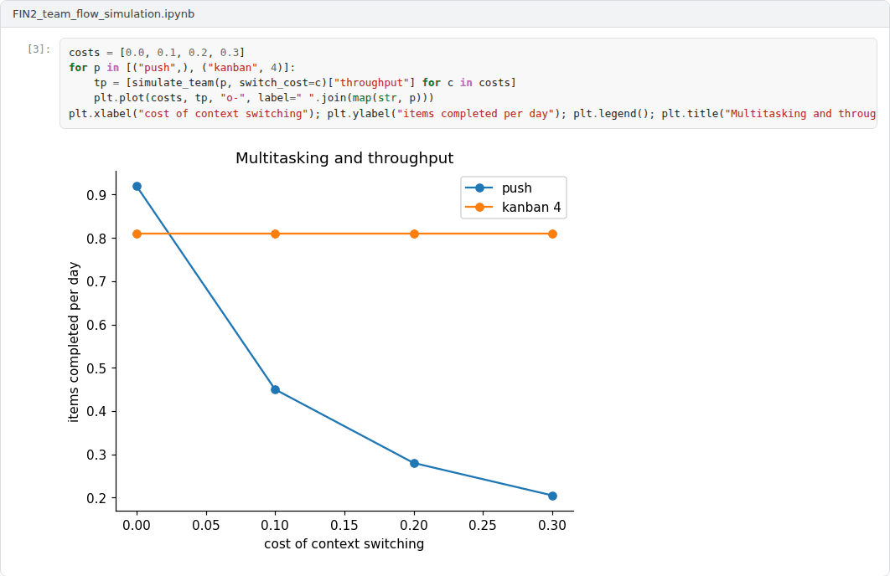
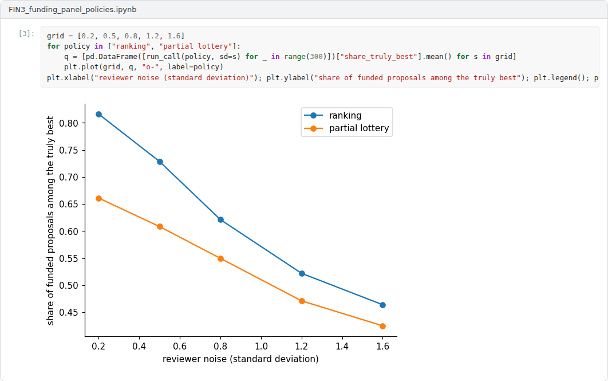

# Final Capstone: Managing Research Projects

**R&D and Project Management in Computer Science (11117BLG002)**  
Prof. Dr. Utku Kose, Süleyman Demirel University

## Overview

The final capstone integrates Weeks 8 to 14: estimation, scheduling, risk, agile methods, earned value, teams and open science, and the route from research to impact [1, 2, 3, 4]. Some topics and projects also draw on earlier weeks, as their week labels show. Students choose the research track or the application track.

## Formats

Two tracks are available. In the research track, the capstone is a theoretical research report of 3500 to 5000 words on a project management topic, based on at least ten scholarly or official sources. In the application track, the capstone extends one of the three example Colab notebooks. A report of 2500 to 4000 words states the question, the model, the experiments and the practical implications for research projects. Each student works individually. The weights below are indicative; in active semesters the instructor confirms them at the start of the semester.

## How to work on this capstone

Both tracks are assessed with the same criteria, which are listed below. The research track suits students who want to analyse a project management topic from the literature. The application track suits students who want to extend a simulation and interpret its results.

### Research track

**Step 1. Choose a topic.** Pick one of the suggested research topics below, or propose a related topic to the instructor. The week in brackets after each topic shows where the course treats it.

**Step 2. Read.** Reread the lecture of the week or weeks named after the topic. Collect at least ten scholarly or official sources, starting from the references of those lectures.

**Step 3. Analyse.** State a clear question and compare what the sources say about it, including the evidence for and against each position.

**Step 4. Write.** Write the report with the course report template. End with recommendations for managing research projects.

**Step 5. Submit.** Send the report as a PDF file. The submission section below gives the deadline for active semesters.

### Application track

**Step 1. Choose a project.** Pick one of the three advanced application projects below. The related weeks of each project show which lecture pages, interactive labs and Colab notebooks to revisit.

**Step 2. Run the example.** Open the example Colab notebook of the project with its badge. Save a copy to your own Google Drive (File, Save a copy in Drive), run all cells from top to bottom and read what the baseline implements.

**Step 3. Extend it.** Implement every required extension in your copy. Fix the random seeds so that another person can reproduce the results.

**Step 4. Evaluate and write.** Compare the extensions with the baseline, including a sensitivity analysis, and write the report with the course report template. End with practical implications for research projects.

**Step 5. Submit.** Send the report as a PDF file and a link to your Colab notebook with view access. The submission section below gives the deadline for active semesters.

## Suggested research topics

The titles below are starting points. Students may narrow a title or propose a related one that fits the scope of the capstone.

1. The planning fallacy and reference class forecasting in software and research projects (Week 8)
2. Critical path, resource constraints and buffers: Scheduling approaches for research projects compared (Week 9)
3. Earned value management for knowledge work: Measuring progress when outcomes are uncertain (Week 12)
4. Risk matrices versus quantitative risk analysis: Evidence and practice (Week 10)
5. Agile methods inside grant agreements: Governance models for iterative research (Week 11)
6. Peer review of grant proposals: Reliability, bias and the case for partial lotteries (Week 7)
7. Team size, disruption and the organisation of research projects (Week 13)
8. Open science practices as requirements of project management (Week 13)
9. Technology readiness levels for software and AI: Suitability and alternatives (Week 1)
10. Portfolio management of research projects in universities and technology transfer offices (Weeks 1 and 14)

## Advanced application projects

Each project comes with an example Colab notebook that implements a working baseline. The capstone extends the baseline as described, evaluates the extensions and reports the results.

### Project 1: A Monte Carlo risk engine with correlated durations and risk events

**Related weeks.** Weeks 9 and 10. Lecture: section "PERT and the probability of meeting a deadline" of Week 9, and sections "The limits of risk matrices" and "Monte Carlo schedule risk" of Week 10. Interactive lab: Part B of Week 10, the Monte Carlo schedule. Colab notebooks: Weeks 9 and 10.

The schedule network of Weeks 9 and 10 is extended with correlated task durations through a Gaussian copula, discrete risk events with probabilities and impacts, and task costs. The example reports percentiles of duration and cost, the criticality index of every task and the correlation of each task with the total [2, 5].

**Required extensions.** Add resource constraints or shared staff, and risk responses whose cost can be compared with the risk they remove. Add a calibration step that sets the distributions from historical data or expert ranges. Compare the resulting contingency with the deterministic plan and with PERT, and discuss the criticism of qualitative risk scoring [6, 7].

 Example Colab notebook: `FIN1_correlated_risk_simulation.ipynb`

### Project 2: An agent-based simulation of a research team: Scrum, Kanban and multitasking

**Related weeks.** Week 11. Lecture: sections "Scrum", "Flow and Little's law" and "Agile inside a research grant". Interactive lab: Part A, which simulates work in progress and cycle time. Colab notebook: Sections 1 and 2.

A team of four researchers works through a backlog of uncertain tasks that generates new work as it is completed. The example compares pushing all work into progress, Scrum sprints and Kanban with three different limits on work in progress. In Scrum, the commitment follows the effort delivered in recent sprints. Switching between tasks has a cost [3, 8, 9].

**Required extensions.** Add milestones with deadlines from a grant agreement, heterogeneous skills and absences, and measure lateness against milestones as well as throughput and cycle time. Check numerically that the average work in progress equals throughput times the average cycle time, as Little's law requires. Compare the behaviour of the model with the literature on agile research projects, and recommend a working method for a funded project [10, 11].

 Example Colab notebook: `FIN2_team_flow_simulation.ipynb`

### Project 3: Funding panel policies: Ranking, partial lotteries and bias

**Related weeks.** Week 7, and Weeks 4 and 5 for the funding programmes. Lecture: sections "How proposals are evaluated" and "How reliable is peer review?" of Week 7. Interactive lab: Part B of Week 7, which simulates panels with noisy reviewers. Colab notebook: Section 2 of Week 7.

A call with 100 proposals and funds for 20 is decided by noisy reviewers who slightly favour established applicants. The example compares three policies: pure ranking, a partial lottery and a lottery above a threshold. The partial lottery funds the clear leaders and draws the rest from the next band. The policies are compared by the quality funded and by the share of established applicants [12, 13].

**Required extensions.** Add the costs of reviewing, panels of different sizes, and bias that grows with the reviewers' uncertainty. Identify the conditions under which partial lotteries lose little quality while reducing bias, and discuss the implications for applicants and funders, including the programmes of Weeks 4 and 5.

 Example Colab notebook: `FIN3_funding_panel_policies.ipynb`

## Report

Both tracks follow the course report template. The report states a question, justifies the approach, presents evidence from the literature or from the simulation with figures, discusses limitations and ends with recommendations for managing research projects. Sources are cited in square brackets.

A common structure for reports is given in the [report template](https://github.com/utkukose/rd-project-management-NB-lecture/blob/main/exams/REPORT_TEMPLATE.md).

## Assessment criteria

| Criterion | Weight | What is assessed |
|---|---|---|
| Question and argument or model design | 30% | A focused question and a sound argument or a well-justified simulation model. |
| Use of the literature | 20% | Accurate and critical use of research and standards on project management. |
| Analysis and evidence | 25% | Research track: depth of analysis. Application track: correct, reproducible experiments with sensitivity analysis. |
| Implications for research projects | 15% | Concrete, well-supported recommendations. |
| Writing and referencing | 10% | Clear structure and correct references. |

## Submission

This capstone also supports self-learning and can be completed at any pace. In an active semester, the final capstone is sent by e-mail to utkukose@sdu.edu.tr or utkukose@gmail.com. The deadline is 23:53 (Türkiye time) on the Sunday that ends Week 14. The e-mail contains the report as a PDF file. In the application track, it also contains a link to the Colab notebook.

## References

[1] Project Management Institute (2021). *A Guide to the Project Management Body of Knowledge (PMBOK Guide) and The Standard for Project Management* (7th ed.). Project Management Institute.

[2] ISO (2018). *ISO 31000:2018 Risk management: Guidelines*. International Organization for Standardization.

[3] Schwaber, K., & Sutherland, J. (2020). *The Scrum Guide: The Definitive Guide to Scrum: The Rules of the Game*. <https://scrumguides.org>

[4] Project Management Institute (2019). *The Standard for Earned Value Management*. Project Management Institute.

[5] Vose, D. (2008). *Risk Analysis: A Quantitative Guide* (3rd ed.). Wiley.

[6] Hubbard, D. W. (2009). *The Failure of Risk Management: Why It's Broken and How to Fix It*. Wiley.

[7] Malcolm, D. G., Roseboom, J. H., Clark, C. E., & Fazar, W. (1959). Application of a technique for research and development program evaluation. *Operations Research*, 7(5), 646-669. <https://doi.org/10.1287/opre.7.5.646>

[8] Anderson, D. J. (2010). *Kanban: Successful Evolutionary Change for Your Technology Business*. Blue Hole Press.

[9] Little, J. D. C. (1961). A proof for the queuing formula: L = λW. *Operations Research*, 9(3), 383-387. <https://doi.org/10.1287/opre.9.3.383>

[10] Marchesi, M., Mannaro, K., Uras, S., & Locci, M. (2007). Distributed Scrum in research project management. In *Agile Processes in Software Engineering and Extreme Programming (XP 2007), Lecture Notes in Computer Science 4536* (pp. 240-244). <https://doi.org/10.1007/978-3-540-73101-6_45>

[11] Dingsøyr, T., Nerur, S., Balijepally, V., & Moe, N. B. (2012). A decade of agile methodologies: Towards explaining agile software development. *Journal of Systems and Software*, 85(6), 1213-1221. <https://doi.org/10.1016/j.jss.2012.02.033>

[12] Pier, E. L., Brauer, M., Filut, A., Kaatz, A., Raclaw, J., Nathan, M. J., Ford, C. E., & Carnes, M. (2018). Low agreement among reviewers evaluating the same NIH grant applications. *Proceedings of the National Academy of Sciences*, 115(12), 2952-2957. <https://doi.org/10.1073/pnas.1714379115>

[13] Graves, N., Barnett, A. G., & Clarke, P. (2011). Funding grant proposals for scientific research: Retrospective analysis of scores by members of grant review panel. *BMJ*, 343, d4797. <https://doi.org/10.1136/bmj.d4797>

---

R&D and Project Management in Computer Science. Prof. Dr. Utku Kose, Süleyman Demirel University. ORCID [0000-0002-9652-6415](https://orcid.org/0000-0002-9652-6415). Content licensed under CC BY 4.0. This course is updated in line with current developments in the field. First version: September 2026. Last update: October 2026.
