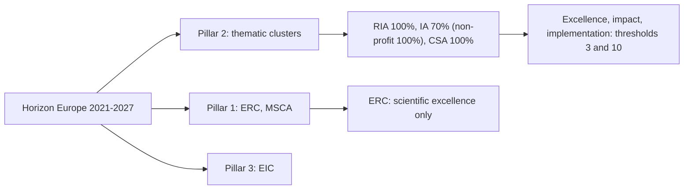
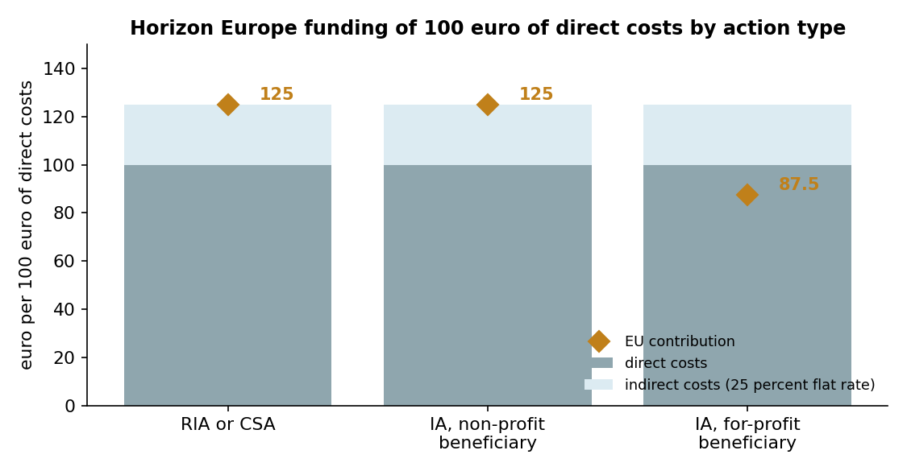
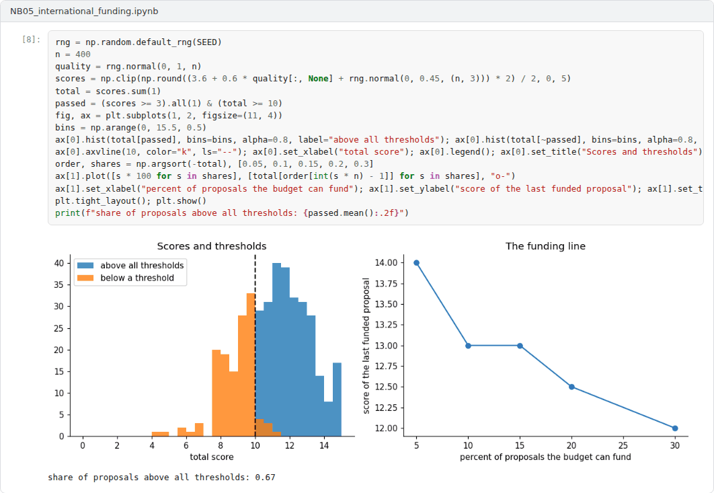

# Week 05: International Research Funding: Horizon Europe, ERC and Beyond

**R&D and Project Management in Computer Science (11117BLG002)**  
Prof. Dr. Utku Kose, Süleyman Demirel University

   

## Overview

International programmes offer larger budgets, international partners and visibility, at the price of intense competition and detailed rules. This week explains the structure of Horizon Europe, its action types, funding rates and evaluation criteria, the grants of the European Research Council and other international instruments [1, 2, 3].

**Estimated study time:** 6 to 8 hours.

## Learning outcomes

By the end of the week, students are expected to describe the pillars and action types of Horizon Europe and to calculate the EU contribution to a consortium budget. They should be able to apply the evaluation thresholds and ranking rules and to state the main features of ERC grants. Finally, they should be able to identify other international instruments, such as COST, EUREKA and national foundations abroad.

## Study path

| Step | Activity | Suggested time |
|---|---|---|
| 1 | Read the lecture below or the [PDF version](Week05_Lecture_Notes.pdf) | 90 minutes |
| 2 | Explore the [interactive lab](https://utkukose.github.io/rd-project-management-NB-lecture/weeks/week-05/lab.html) | 45 minutes |
| 3 | Work through the [Colab notebook](https://colab.research.google.com/github/utkukose/rd-project-management-NB-lecture/blob/main/weeks/week-05/NB05_international_funding.ipynb) and its exercises | 2 to 3 hours |
| 4 | Take the self-assessment in the interactive lab (tab: Check yourself) | 20 minutes |
| 5 | Answer the reflection prompts in the interactive lab, export the learning log and complete the weekly task | 60 minutes |

## Week at a glance

## Lecture

### Horizon Europe

Horizon Europe is the European Union's research and innovation programme for 2021 to 2027, and it has three pillars. Excellent Science includes the European Research Council and the Marie Skłodowska-Curie Actions. Global Challenges and European Industrial Competitiveness is organised in thematic clusters, and Innovative Europe includes the European Innovation Council. Türkiye is an associated country, so organisations in Türkiye can take part in its calls. Most collaborative calls take one of three forms [2]. Research and innovation actions produce new knowledge or explore new technologies. Innovation actions are closer to the market and produce plans, prototypes and demonstrations. Coordination and support actions fund networking, coordination and dissemination rather than research.

<b>Check your understanding.</b> In which pillar of Horizon Europe is the European Research Council?

A. Pillar I, Excellent Science  
B. Pillar II, Global Challenges and European Industrial Competitiveness  
C. Pillar III, Innovative Europe  
D. Widening participation and strengthening the European Research Area  

**Answer: A.** The ERC funds investigator-driven frontier research.

### Funding rates and budgets

Research and innovation actions and coordination and support actions are funded at 100 percent of eligible costs. Innovation actions are funded at 70 percent, except for non-profit legal entities, which receive 100 percent [2, 4]. Indirect costs are covered by a flat rate of 25 percent of the eligible direct costs, with exclusions such as subcontracting. Figure 5.1 shows the consequence: 100 euro of direct costs yield 125 euro of eligible costs [4]. A non-profit partner receives all 125 euro, while a for-profit partner in an innovation action receives 87.50 euro. The interactive lab and the Colab notebook compute these amounts for a whole consortium.

*Figure 5.1. Eligible costs and EU contribution for 100 euro of direct costs in Horizon Europe, by action type and type of beneficiary [2, 4].*

<b>Check your understanding.</b> What is the funding rate of an Innovation Action for a for-profit company?

A. 100 percent  
B. 50 percent  
C. 70 percent  
D. 25 percent  

**Answer: C.** Research and Innovation Actions are funded at 100 percent. Non-profit participants in Innovation Actions also receive 100 percent.

### Evaluation

Collaborative proposals are scored by independent experts on three criteria: excellence, impact, and the quality and efficiency of the implementation [1]. Each criterion is scored from 0 to 5. By default, a proposal must reach at least 3 on each criterion and at least 10 in total to be considered for funding, unless the work programme states otherwise. Scores are normally not weighted, but for innovation actions the impact criterion receives a weight of 1.5 when proposals are ranked, not when thresholds are checked. Page limits are set in the proposal template of each call and were changed for the 2026 and 2027 work programmes. The template attached to the call is therefore the only authoritative source.

<b>Check your understanding.</b> Which thresholds apply to the three evaluation criteria in most Horizon Europe calls?

A. 2 out of 5 for each criterion  
B. 3 out of 5 for each criterion and 10 out of 15 in total  
C. 4 out of 5 for excellence only  
D. No thresholds are used  

**Answer: B.** Proposals below any threshold are not considered for funding, whatever their total.

### The ERC and other instruments

The European Research Council funds investigator-driven frontier research with a single evaluation criterion, scientific excellence. For the 2026 calls, Starting Grants of up to 1.5 million euro for five years address researchers 2 to 7 years after the doctorate [3]. Consolidator Grants of up to 2 million euro address those 7 to 12 years after it. Advanced Grants of up to 2.5 million euro address established leaders. Additional funding of up to 1 million euro can be requested, and up to 2 million euro for researchers moving to Europe from elsewhere. From 2027, the Starting Grant window will run from the doctorate to 10 years after it, and the Consolidator window from 5 to 15 years [5].

Other instruments serve other purposes. COST Actions fund research networks rather than research itself. EUREKA and its Eurostars programme support market-oriented projects of companies, with national funding that TÜBİTAK provides through its 1509 programme. Outside Europe, funders apply their own criteria: The National Science Foundation of the United States, for example, reviews proposals for intellectual merit and broader impacts [6].

> **Pause and reflect.** Would your project idea fit a research and innovation action, an innovation action or an ERC grant? What would have to change for it to fit another instrument?

<b>Check your understanding.</b> What is the maximum ERC Starting Grant in the 2026 work programme?

A. 500,000 euro  
B. 10 million euro  
C. 2.5 million euro  
D. 1.5 million euro for up to five years  

**Answer: D.** Additional funds can be requested for specific costs, and eligibility depends on the years since the PhD.

## Interactive lab

Part A computes eligible costs and the EU contribution for a three-partner consortium. Part B applies the thresholds and the ranking rule. Part C compares ERC eligibility windows under the 2026 and 2027 rules [1, 2, 5].

[Open the interactive lab](https://utkukose.github.io/rd-project-management-NB-lecture/weeks/week-05/lab.html)

## Colab notebook

The Colab notebook computes the EU contribution to a Horizon Europe consortium with the official funding rates and the flat rate for indirect costs. It then applies the thresholds and the ranking rule to a set of scored proposals [1, 2].

Screenshots of the executed Colab notebook:

## Self-assessment and reflection

The interactive lab contains a self-assessment of six questions (tab: Check yourself). Students answer each question, state how sure they are and receive instant feedback. A confident but wrong answer marks the first topic to revisit. The reflection prompts below also appear in the interactive lab (tab: Reflect and submit). Answers written there are saved in the browser and can be exported as a learning log.

1. Which Horizon Europe action type suits your project idea, and what does that imply for your partners?
2. How would a 70 percent funding rate change the decision of a company to join a consortium?
3. Which international instrument could help you build a network before a full proposal?

## Weekly task and submission

**What to do.** Draft a one-page concept note for an international call of your choice, such as a Horizon Europe call. Name the call and the type of action, and describe the consortium with the role of each partner. Give a budget with the EU contribution computed as in the Colab notebook. End with one paragraph on how the proposal will address each evaluation criterion. Cite the official work programme.

**Where to look.** Lecture: sections "Horizon Europe", "Funding rates and budgets" and "Evaluation". Interactive lab: Part A for the consortium budget and Part B for thresholds and ranking. Colab notebook: Section 1 for the EU contribution and Section 2 for thresholds and ranking.

**Example.** A research and innovation action could bring together a university, a hospital and a software company. Suppose that the direct costs of the university, excluding subcontracting, are 400,000 euro. The 25 percent flat rate for indirect costs then gives eligible costs of 500,000 euro. At the funding rate of 100 percent, the EU contribution to the university would also be 500,000 euro.

**What to submit.** The one-page concept note, and the Colab notebook with Exercises 1 and 2 completed.

The weekly task supports self-learning and builds a personal portfolio. In an active semester, students who follow the course with the instructor can send their work for evaluation to utkukose@sdu.edu.tr or utkukose@gmail.com. The e-mail contains the items that the task lists under What to submit. It also includes the learning log exported from the interactive lab (tab: Reflect and submit).

## Research and report assignment (optional)

**Participation in Horizon Europe.** How do organisations from Türkiye take part in Horizon Europe?

**What to do.** Use the public data of the European Commission on Horizon Europe projects. Analyse the participation of organisations from Türkiye in one thematic area. Then discuss the factors that research suggests influence success [1, 7].

**Where to start.** Lecture sections "Horizon Europe" and "Evaluation", and the public data on Horizon Europe projects published by the European Commission.

**Example focus.** The report could compare the success rate of proposals with a partner from Türkiye with the average success rate in the same cluster.

This research assignment is optional and supports self-learning. In an active semester, students who follow these weeks with the instructor can send the report for evaluation to utkukose@sdu.edu.tr or utkukose@gmail.com. The report has 1500 to 2500 words and follows the structure of an academic paper. It cites at least six scholarly or official sources in square brackets and ends with a reference list. The [report template](https://github.com/utkukose/rd-project-management-NB-lecture/blob/main/exams/REPORT_TEMPLATE.md) shows a suitable structure.

## References

[1] European Commission (2021). *Standard briefing slides for experts: Horizon Europe*. <https://ec.europa.eu/info/funding-tenders/opportunities/docs/2021-2027/experts/standard-briefing-slides-for-experts_he_en.pdf>

[2] European Commission (2024). *Lump sum funding in Horizon Europe: What do I need to know?*. <https://ec.europa.eu/info/funding-tenders/opportunities/docs/2021-2027/horizon/guidance/ls-funding-what-do-i-need-to-know_he_en.pdf>

[3] European Commission (2025). *Horizon Europe Work Programme 2026: European Research Council*. <https://ec.europa.eu/info/funding-tenders/opportunities/docs/2021-2027/horizon/wp-call/2026/wp_horizon-erc-2026_en.pdf>

[4] FFG, Austrian Research Promotion Agency (2026). *Funding rates in Horizon Europe*. <https://www.ffg.at/en/europe/heu/legal-financial/theme_funding-rates>

[5] European Research Council (2025). *Changes to the 2026 and 2027 Work Programmes*. <https://erc.europa.eu/news-events/news/changes-2026-and-2027-work-programmes>

[6] National Science Foundation (2026). *Merit review: Intellectual merit and broader impacts*. <https://www.nsf.gov>

[7] European Commission (2024). *Horizon Europe Work Programme 2023-2025: 13. General Annexes*. <https://ec.europa.eu/info/funding-tenders/opportunities/docs/2021-2027/horizon/wp-call/2023-2024/wp-13-general-annexes_horizon-2023-2024_en.pdf>

---

R&D and Project Management in Computer Science. Prof. Dr. Utku Kose, Süleyman Demirel University. ORCID [0000-0002-9652-6415](https://orcid.org/0000-0002-9652-6415). Content licensed under CC BY 4.0. This course is updated in line with current developments in the field. First version: September 2026. Last update: October 2026.
