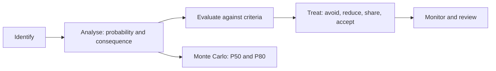
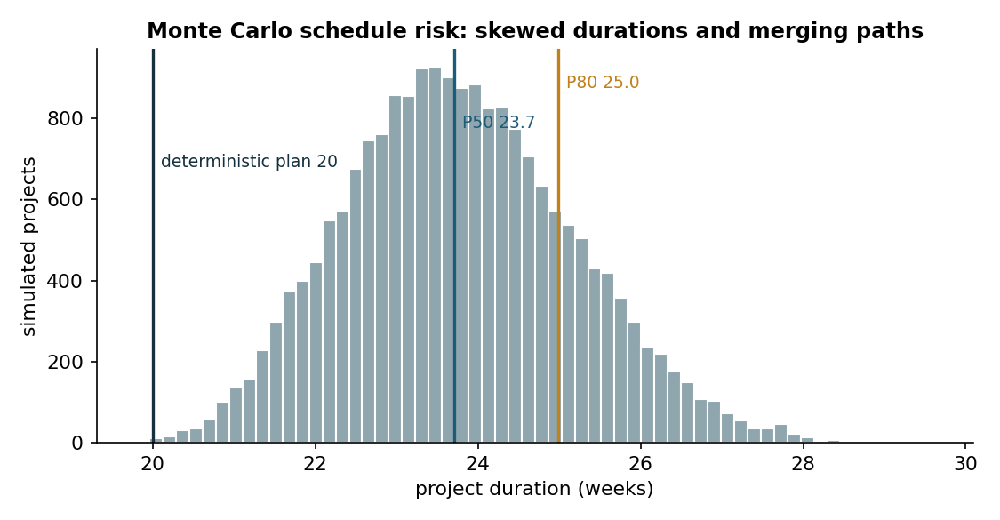
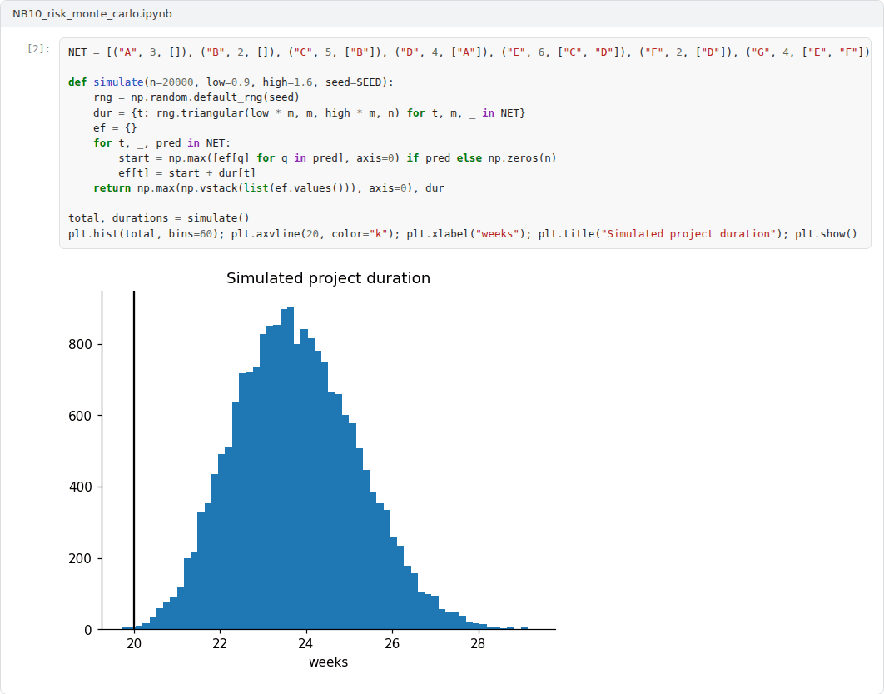

# Week 10: Risk Management and Monte Carlo Simulation

**R&D and Project Management in Computer Science (11117BLG002)**  
Prof. Dr. Utku Kose, Süleyman Demirel University

   

## Overview

Research projects are uncertain by definition, so their plans must manage risk explicitly. This week follows the risk management process of ISO 31000, compares qualitative risk matrices with quantitative analysis and uses Monte Carlo simulation to estimate schedule risk [1, 2, 3].

**Estimated study time:** 6 to 8 hours.

## Learning outcomes

By the end of the week, students are expected to identify, analyse and treat project risks with a risk register and to compute risk exposure. They should be able to explain the limitations of qualitative risk matrices. Finally, they should be able to estimate the distribution of project duration with Monte Carlo simulation, including merge bias.

## Study path

| Step | Activity | Suggested time |
|---|---|---|
| 1 | Read the lecture below or the [PDF version](Week10_Lecture_Notes.pdf) | 90 minutes |
| 2 | Explore the [interactive lab](https://utkukose.github.io/rd-project-management-NB-lecture/weeks/week-10/lab.html) | 45 minutes |
| 3 | Work through the [Colab notebook](https://colab.research.google.com/github/utkukose/rd-project-management-NB-lecture/blob/main/weeks/week-10/NB10_risk_monte_carlo.ipynb) and its exercises | 2 to 3 hours |
| 4 | Take the self-assessment in the interactive lab (tab: Check yourself) | 20 minutes |
| 5 | Answer the reflection prompts in the interactive lab, export the learning log and complete the weekly task | 60 minutes |

## Week at a glance

## Lecture

### The risk management process

ISO 31000 defines risk as the effect of uncertainty on objectives and describes risk management through principles, a framework and a process [1]. The process identifies risks, analyses their likelihood and consequences, evaluates them against criteria, treats them and monitors them, with communication and consultation throughout. Treatment options include avoiding the risk, reducing its likelihood or consequences, sharing it and accepting it. In a proposal, the risk section shows reviewers that the team has thought about what could go wrong and has credible alternatives. TÜBİTAK's form asks for these alternatives as a plan B [4].

<b>Check your understanding.</b> Which steps belong to the risk management process of ISO 31000?

A. Identification, analysis, evaluation and treatment, with monitoring and communication  
B. Only insurance  
C. Only a risk matrix  
D. Budgeting and procurement  

**Answer: A.** The process is iterative and embedded in decision-making.

### Risk registers and exposure

Boehm introduced risk management to software engineering and defined risk exposure as the probability of an unsatisfactory outcome multiplied by the loss it would cause [2]. A risk register lists each risk with its probability, impact, exposure, owner, mitigation and trigger. Boehm's list of frequent software risks includes personnel shortfalls and unrealistic schedules and budgets, and it remains familiar in research projects. Research adds risks of its own: a hypothesis that turns out false, data that cannot be obtained, and approvals that take longer than planned.

<b>Check your understanding.</b> A risk has a probability of 0.2 and would delay the project by 10 weeks. What is its exposure?

A. 0.2 weeks  
B. 10 weeks  
C. 2 weeks  
D. 12 weeks  

**Answer: C.** Exposure is probability times impact.

### The limits of risk matrices

Probability-impact matrices are popular because they are simple. Hubbard argued that many common risk scoring methods, including ordinal scales and matrices, can mislead [5]. They compress different risks into the same cell and rank risks inconsistently. They also give an impression of precision that the underlying judgements do not have. He recommended quantitative methods based on calibrated probability estimates. The interactive lab uses a matrix for communication and a simulation for decisions, which reflects this advice.

<b>Check your understanding.</b> Why can risk matrices mislead?

A. They are too colourful  
B. Coarse categories can rank risks incorrectly and hide differences in magnitude  
C. They require software  
D. They use probabilities  

**Answer: B.** Quantitative estimates avoid the range compression of ordinal categories.

### Monte Carlo schedule risk

Monte Carlo simulation replaces single durations with probability distributions, samples every task many times and computes the project duration for each sample [3]. The result is a distribution from which percentiles such as P50 and P80 can be read, the durations that the project will meet with 50 and 80 percent probability. Figure 10.1 applies the method to the network of Week 9 with right-skewed durations. Two effects make the simulated durations longer than the deterministic plan of 20 weeks. Skewed tasks are more likely to overrun than to finish early. Where paths merge, the later of the two paths determines the start of the next task, so the expected merge time exceeds the time of either path. This merge bias is invisible to PERT.

> **Pause and reflect.** Would you commit to the P50 or the P80 duration in a proposal? What would the funder and your team each prefer?

*Figure 10.1. Distribution of the duration of the example project in 20,000 Monte Carlo runs with triangular task durations from 0.9 to 1.6 times the planned value [3].*

<b>Check your understanding.</b> What does a Monte Carlo schedule analysis provide?

A. A single completion date  
B. A list of team members  
C. A distribution of completion dates from which percentiles such as P80 can be read  
D. A Gantt chart only  

**Answer: C.** Percentiles support contingency decisions better than a single deterministic date.

## Interactive lab

Part A places the risks of a research project on a probability-impact matrix and ranks them by exposure. Part B simulates the duration of the Week 9 project with uncertain task durations and shows the effect of merging paths [2, 3].

[Open the interactive lab](https://utkukose.github.io/rd-project-management-NB-lecture/weeks/week-10/lab.html)

## Colab notebook

The Colab notebook simulates the duration of the Week 9 project with triangular task durations, reads percentiles from the distribution and identifies the tasks that drive the uncertainty [3].

Screenshots of the executed Colab notebook:

## Self-assessment and reflection

The interactive lab contains a self-assessment of six questions (tab: Check yourself). Students answer each question, state how sure they are and receive instant feedback. A confident but wrong answer marks the first topic to revisit. The reflection prompts below also appear in the interactive lab (tab: Reflect and submit). Answers written there are saved in the browser and can be exported as a learning log.

1. Which risk in your register has the highest exposure, and is your mitigation proportionate to it?
2. Why might a team prefer to report P50 in a proposal while a funder would prefer P80?
3. Which task drives the uncertainty of your schedule, and can it be started earlier or split?

## Weekly task and submission

**What to do.** Analyse the risks of your project in two ways. First, build a risk register of at least eight risks. For each risk, give the probability, the impact, the exposure, an owner, a mitigation and a plan B. Second, run a Monte Carlo analysis of your schedule from Week 9 and report the P50 and P80 durations. Finally, state the duration you would commit to in the proposal and justify it.

**Where to look.** Lecture: sections "Risk registers and exposure", "The limits of risk matrices" and "Monte Carlo schedule risk". Interactive lab: Part A for the risk register and Part B for the Monte Carlo schedule. Colab notebook: Section 1 with both exercises.

**Example.** The risk that a hospital delays access to data could have probability 0.4 and an impact of 8 weeks, so its exposure is 3.2 weeks. Its plan B could be a public data set with a similar structure.

**What to submit.** The risk register, the Monte Carlo results with a short justification of the committed duration, and the Colab notebook with Exercises 1 and 2 completed.

The weekly task supports self-learning and builds a personal portfolio. In an active semester, students who follow the course with the instructor can send their work for evaluation to utkukose@sdu.edu.tr or utkukose@gmail.com. The e-mail contains the items that the task lists under What to submit. It also includes the learning log exported from the interactive lab (tab: Reflect and submit).

## Research and report assignment (optional)

**Quantitative risk analysis in practice.** How do organisations analyse project risks, and what are the limits of risk matrices?

**What to do.** Review how organisations apply ISO 31000 and Monte Carlo analysis to projects [1, 3]. Summarise the evidence on the limitations of qualitative risk matrices [5].

**Where to start.** Lecture sections "The risk management process", "The limits of risk matrices" and "Monte Carlo schedule risk".

**Example focus.** Two risks with very different expected losses can fall into the same cell of a matrix. The report could look for documented cases of this problem.

This research assignment is optional and supports self-learning. In an active semester, students who follow these weeks with the instructor can send the report for evaluation to utkukose@sdu.edu.tr or utkukose@gmail.com. The report has 1500 to 2500 words and follows the structure of an academic paper. It cites at least six scholarly or official sources in square brackets and ends with a reference list. The [report template](https://github.com/utkukose/rd-project-management-NB-lecture/blob/main/exams/REPORT_TEMPLATE.md) shows a suitable structure.

## References

[1] ISO (2018). *ISO 31000:2018 Risk management: Guidelines*. International Organization for Standardization.

[2] Boehm, B. W. (1991). Software risk management: Principles and practices. *IEEE Software*, 8(1), 32-41. <https://doi.org/10.1109/52.62930>

[3] Vose, D. (2008). *Risk Analysis: A Quantitative Guide* (3rd ed.). Wiley.

[4] TÜBİTAK (2026). *1001 Bilimsel ve Teknolojik Araştırma Projelerini Destekleme Programı: Proje başvuru formu*. <https://tubitak.gov.tr/sites/default/files/20689/1001_basvuru_formu.doc>

[5] Hubbard, D. W. (2009). *The Failure of Risk Management: Why It's Broken and How to Fix It*. Wiley.

---

R&D and Project Management in Computer Science. Prof. Dr. Utku Kose, Süleyman Demirel University. ORCID [0000-0002-9652-6415](https://orcid.org/0000-0002-9652-6415). Content licensed under CC BY 4.0. This course is updated in line with current developments in the field. First version: September 2026. Last update: October 2026.
